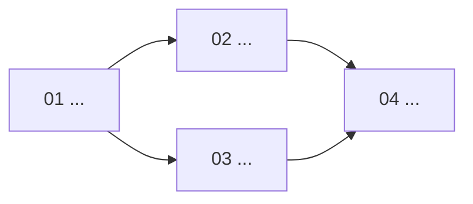

# PROMPT_CREATE_FEATURE — Generate a lean feature plan under your session

You are a code agent (Claude Code / Cursor / Codex) running at the **root of a workspace**. Execute this file as your complete task spec. You will **plan a feature** — you write planning documents only, **never product code**.

The trigger supplies `USER: <username>`. Every planning file you write goes under `.agentic_planning/<USER>/`. If that directory does not exist, stop and tell the operator to run trigger 0 (open session) first. **Never write into another user's session directory** or read another user's plans to inform this one. The only later exception is the mandatory route-5 close invoked by this plan's final executing step; it enumerates session paths for the shared index but writes only this user's row.

Treat the free text after "Feature to build:" in the trigger as the feature intent. If it is empty or one ambiguous line, ask up to **3** crisp clarifying questions before planning; otherwise proceed.

Use `PROFILE: BASE` for route 2 and `PROFILE: HARDENING` when called by route 6. Read [the shared quality and security prompt](./PROMPT_HARDENING_AND_AUDIT.md) §§ Execution budget, Base quality and Security audit → Base. For route 6, use § Hardening's execution and acceptance criteria while planning. Validate `MAX_SESSIONS` (default 1, or 2) and explicitly requested `EXTRA_CHECKS`.

---

## Goal

Produce a small, executable plan under `.agentic_planning/<USER>/_feature_<slug>/` with single-session steps, explicit dependencies, individual triggers and one-line model effort hints. Code steps implement binding behavioral cases from the contract and pass applicable required and selected opt-in checks. Follow the security review and execution budget for the chosen profile. Provide a manual acceptance checklist for the user.

## Inputs — read before planning

1. **`WORKSPACE_MAP.md`**: scan headings, then read maturity, workspace-wide rules/resources, touched subprojects and their shared dependencies/Unknowns. Ground commands/cwd, gates, contracts, access modes, seams, recipes, libraries and conventions there. If missing, stale for required facts, lacking Quality gates or the `Existing docs & planning` global-close entry, direct the operator to INIT (trigger 1). An absent unselected opt-in alone does not make a legacy map stale.
2. **`CLAUDE.md` / `AGENTS.md`** (root and applicable layers) — mandatory instructions; reuse unchanged content already in this session's context.
3. **`agentic-planning-kit/TRIGGERS.md` route 5** and `PROMPT_INIT.md`'s `RECONCILE_FEATURE` section plus its referenced sections — the terminal close protocol; skip unrelated modes.
4. **Your own prior features**, if needed for style: read the relevant section of one representative feature, not the session's full history.

## The method

A feature lives in `.agentic_planning/<USER>/_feature_<slug>/`:

```text
_feature_<slug>/
├── FEATURE_<SLUG>.md   # canonical doc: scope, binding contract, decisions, graph, manual QA checklist
├── TRIGGERS.md         # one launcher per step; the final one invokes route 5 in-process
├── steps/
│   ├── 01-<slug>.md    # step files — single-session, explicit dependencies
│   └── NN-<slug>.md
└── outputs/            # one short report per step (created by the executing sessions)
```

The step table and execution graph live in `FEATURE_<SLUG>.md` §4.

Binding principles:

- **1 step = 1 agent session.** The human schedules from the dependency graph and the plan's `MAX_SESSIONS`. Preserve the shared execution budget and the exclusivity of routes 0/5, heavy checks and full audits.
- **Execution graph, human-readable.** `FEATURE_<SLUG>.md` §4 shows the Mermaid graph and a `Depends on` column. State launch order and, with an explicit limit of 2, which independent steps may overlap and which write scopes and exclusive resources make that safe.
- **Suggested model effort per step.** Every step file carries a one-line `Suggested model effort`: a relative tier (`low` | `medium` | `high`) plus concrete examples for the three agent CLIs the operator uses — **Claude Code** (model + thinking effort), **Codex** (model + reasoning effort), **Cursor** (mode). It is a hint for the human launching the session, not routing machinery: no matrices, no per-step option tables, no fallback chains.
- **Few steps.** Prefer 2–6. Split by subproject and cohesive concern; merge steps that a single ordinary session can finish. A tiny feature may be 1 step.
- **Every step is self-contained.** Its "Before any code, read" names exact paths + headings/subproject or source symbols, including global rules/resources and relevant Unknowns. Read those sections and required instructions, not whole maps/history; reuse unchanged context. Expand when a reference, ambiguity or mismatch requires it. Required reports must follow declared dependency edges; a parallel branch's report is a hidden edge (declare it or drop it).
- **One subproject per product-writing step.** Cross-subproject features get one step per subproject, in dependency order — which is exactly what makes cross-subproject branches parallelizable once the shared contract step lands. Each step passes only *its* subproject's gates.
- **Contracts are defined once** in `FEATURE_<SLUG>.md` §3. Steps cite the exact clauses and shared definitions they need rather than copying the whole contract; keep binding cases and exact gate commands inline. Never re-derive a contract; report a mismatch prominently and stop.
- **Binding test cases are planned, not improvised.** For every step that writes product code, derive from the contract (§3) the concrete cases its tests must cover — happy path, negative and edge cases — and write them into the step's `Binding test cases` section. The executing session implements tests for exactly those cases; **it may add cases, never remove or weaken them**. This separation — the planner sets the bar in one session, the executor meets it in another — is what keeps the gauntlet honest.
- **Checks before handoff.** Code steps implement the binding cases and run the planned gate commands. Every changed code, dependency or security-affecting configuration step performs the base security review inline, including config-only steps. Record a reasoned `n/a` for unrelated steps. Applicable project-required checks still apply. Fix failures caused by the step within its scope, and report unrelated blockers.
- **The gauntlet never weakens.** No step may delete, skip, `xfail`/disable or loosen an existing test unless `FEATURE_<SLUG>.md` §3 explicitly changed the contract that test encodes — and then the step must say so in its report. **Every test file touched is listed in the report**, so the operator can audit the diff over tests in seconds without reading product code.
- **Missing and opt-in checks.** Follow § Base quality. In `FEATURE_<SLUG>.md` §6 record unavailable required checks, any tooling bootstrap, and deferred options such as CRAP, duplication and mutation. Hardening lists the extended requirements and owners in §4.
- **Imitate, don't invent.** Each step names the seam (`file:symbol`, map §8), the recipe + exemplar (map §9) and the blessed library (map §2) it follows. No second way to do what already has a way.
- **Scope discipline.** The feature doc has an explicit *Out of scope*. A step that needs something out of scope stops and reports.
- **Data-store safety.** Respect each store's access mode from the map. Migrations run only against local/dev, never production. Read-only/sealed stores get no mutation plan of any kind.
- **Short handoff reports.** `outputs/NN_<slug>.md` (≤40 lines) records results: changed files, gate command + cwd + exit code, tests added/files touched, deviations, blockers and security evidence. Final reports reserve `## Cierre` plus three results. Hardening also links its separate full audit report.
- **Mandatory close/reconcile.** The final step is a join that depends on every other terminal step; if no natural join exists, add one non-code close step within the 2–6 limit. After gates it writes its preliminary handoff, then automatically invokes root route 5 `RECONCILE FEATURE` in the same session with `USER` and `FEATURE_PATH`, filling the reserved close block before success; it is not a human launcher or graph node. Route 5 updates changed factual map sections plus the `Existing docs & planning` pointer, refreshes pointers, rebuilds `.agentic_planning/README.md` and marks execution complete (QA remains pending). Those artifacts are `exclusive`; if close fails, the step reports the blocker and remains unclosed.
- **Session and global index registration.** `.agentic_planning/<USER>/SESSION.md` is the source index for that user; planning adds its newest-first `## Features` row as `📝 Diseñada`, and route 5 alone flips it to `✅ Ejecutada (YYYY-MM-DD)` after reconciliation. `.agentic_planning/README.md` is the generated, deterministic global navigation index of all direct-child sessions; it never becomes a second source of truth. Flip any superseded row of yours while planning.
- **Manual QA checklist for the user.** `FEATURE_<SLUG>.md` §7 lists concrete actions + expected results the user performs by hand (app screens, API calls, DB queries), written **in Spanish** (user-facing). This replaces every automated *acceptance* artifact. The checklist focuses on what gates cannot prove — UX, device flows, visuals, end-to-end acceptance — and need not re-test correctness the binding test cases already cover.
- Generated planning, handoff and audit documents use Markdown. The human launchers and Mermaid graph provide scheduling without an orchestrator.

## Procedure

1. **Parse the intent.** Restate the feature in one sentence. Derive `<slug>` (kebab-case, ≤4 words) and `<SLUG>` (UPPER_SNAKE). If `.agentic_planning/<USER>/_feature_<slug>/` already exists, stop and ask whether to supersede it or pick another slug.
2. **Scope against the map.** Identify the touched subproject(s), the seams/recipes/blessed libs per subproject, **the Quality gates table per touched subproject** (note any `MISSING` gate now — it becomes a bootstrap step or a §6 degradation note), and what is explicitly out of scope. Check data-store access modes for anything the feature writes.
3. **Write `FEATURE_<SLUG>.md`** using the template below (≤200 lines). §3 (contract) is the spine — be concrete: the binding test cases of every code step derive from it.
4. **Decompose into single-session steps within the budget.** The final step depends on every terminal branch. Derive each code step's happy/negative/edge cases from §3 and write its step file (≤60 lines). For hardening, assign the final step ownership of current-scope extended evidence and the full audit before close.
5. **Write compact `TRIGGERS.md`** — one step-file pointer in launch order. Append route 5 to the terminal launcher after required checks and preliminary handoff.
6. **Register the feature in `.agentic_planning/<USER>/SESSION.md`**: insert its row at the top of `## Features` as `📝 Diseñada` with its one-line description and impacts; flip any superseded row of yours. Route 5, not the planner, performs the final `✅ Ejecutada` update.
7. **Print a summary** with slug, launch order and allowed overlaps, touched subprojects, gates per step, deferred checks and assumptions.

---

## Template — `FEATURE_<SLUG>.md`

````markdown
# Feature: <short title> — <one-line subtitle>

**Canonical feature document.** <2–4 sentences: what it delivers and what it explicitly does not do.>

**Status:** design approved, pending execution.
**Owner session:** `.agentic_planning/<USER>/`
**Launchers:** [`TRIGGERS.md`](./TRIGGERS.md)

## 1. Motivation
<The why, numbered and brief. Ground in real files/behavior from WORKSPACE_MAP.md.>

## 2. Scope
| Subproject / layer | Change |
|--------------------|--------|
| ...                | ...    |

**Out of scope (not built):** <explicit list.>

## 3. Canonical contract
**Binding.** Steps code against it and never redefine it. The binding test cases of every code step derive from this section.
<Concrete enums, schemas, validation rules, derivation tables. Specific, not hand-wavy.>

## 4. Steps

| # | Step | Subproject | Depends on | Suggested effort | Gates | Writes | Report |
|---|------|-----------|------------|------------------|-------|--------|--------|
| 01 | ... | ... | — | medium | <map gates or `n/a (no product code)`> | ... | `outputs/01_<slug>.md` |



`PROFILE: <BASE|HARDENING>` · `MAX_SESSIONS: <1|2>`. List any selected opt-in checks, the permitted launch order and isolation evidence for overlaps, if any.

## 5. Fixed design decisions
1. <decision + why, so an executing agent doesn't relitigate it.>

## 6. Invariants and anti-patterns
1. **The gauntlet never weakens:** no existing test is deleted, skipped or loosened; the only exception is an explicit contract change in §3, which the step must report. Every test file touched appears in the step report.
2. <must stay true across all steps — include the workspace map's hard rules that this feature touches.>
<List missing checks and their disposition, plus optional extended checks deferred for this plan.>
- Anti-pattern: <a tempting wrong turn to avoid.>

## 7. QA manual (usuario)
<En español. Lista concreta de acciones + resultado esperado, ejecutable a mano por el usuario al terminar todos los pasos: pantallas, llamadas API, queries. Sin automatización. Enfocada en aceptación — UX, flujos en dispositivo, resultado visual — no en la corrección que los gates y los test cases vinculantes ya probaron.>

| # | Acción | Resultado esperado |
|---|--------|--------------------|
| 1 | ...    | ...                |

## 8. References
| Topic | Location |
|-------|----------|
| Workspace map | `WORKSPACE_MAP.md` |
| Quality gates | `WORKSPACE_MAP.md` §4 (touched subprojects) |
| Recipe(s) followed | `WORKSPACE_MAP.md` §9 + exemplar `file` |
| <contract/seam> | `file` |

_Created: <month year>. Origin: <one line>._
````

## Template — a step file `steps/NN-<slug>.md`

````markdown
# NN — <step title>

## Goal
<What this single session produces.>

## Depends on
<step numbers whose reports this step needs, or `none`; follow the plan's launch order and session limit.>

## Suggested model effort
<tier + one example per CLI, one line — e.g. `medium — Claude Code: Sonnet (thinking medium) · Codex: gpt-5-codex (reasoning medium) · Cursor: Auto`. A hint for the operator, not a requirement.>

## Before any code, read
- <root and applicable layer `CLAUDE.md`/`AGENTS.md`; reuse if already in context and unchanged>.
- `WORKSPACE_MAP.md` — <exact headings + subproject: maturity, global rules/resources, applicable Unknowns, commands/cwd, access modes, seams/recipes/libs and all applicable Quality gates for code steps>.
- `../FEATURE_<SLUG>.md` — §2, §5–6 (scope/decisions/invariants); §3 <exact contract clauses + shared definitions needed>.
- `agentic-planning-kit/PROMPT_HARDENING_AND_AUDIT.md` — § Base quality and § Security audit → Base. Owners of selected UB checks also read § UB quality suite. Hardening final step reads § Hardening and § Security audit → Full.
- <source `path:symbol` + purpose; dependency `../outputs/NN_*.md` outcome/blockers + needed headings, or `none`>.
Read these sections, not entire referenced files by default; follow necessary references or widen for ambiguity. Mandatory instructions and relevant constraints are never omitted to save context.

## Subproject
<exactly one; its cwd and commands from the map.>

## Spec
<What to build; seam `file:symbol`, recipe + exemplar, blessed library. Cite canonical clauses. Write only declared deliverables; stop and report scope or contract mismatches.>

## Binding test cases
<Code steps only — write `not applicable (no product code)` otherwise. The concrete cases this step's tests MUST cover, derived from FEATURE §3: happy path, negative, edge. The executor may add cases, never remove or weaken these.>
1. <case — input/state → expected outcome>
2. <case>
3. <negative/edge case>

## Out of scope
<what this step must NOT touch.>

## Gates
<Required and selected map commands, verbatim + cwd, after implementing the spec and binding cases. Record each exit code. Include applicability/scope of base security, or `n/a` with reason. State commands, scope or prerequisites for assigned UB checks, which follow their suite evidence rules. For the hardening final step state the full audit scope.>

## Deliverables
- <product files/paths>.
- <code steps> tests implementing the binding test cases above, in the subproject's declared test location/style.
- `outputs/NN_<slug>.md` (≤40 lines): changes/files; gate command + cwd + exit code; tests added/files touched; security evidence or reasoned `n/a`; deviations and blockers. The hardening final step links the extended results and full audit evidence before close.
- <final step only> end this ≤40-line preliminary report with `## Cierre` plus three placeholders; invoke root route 5 with `USER: <USER>` and `FEATURE_PATH: .agentic_planning/<USER>/_feature_<slug>/`, then replace those three lines with its map/pointer/index/status result. Do not end successfully if it fails.
````

## Template — `TRIGGERS.md`

Generate one block **per step** in the plan's launch order. Keep execution rules in the step. The final join includes the terminal suffix, even for a one-step feature.

````markdown
# Agent session triggers

Follow the dependency graph and launch order in the feature doc §4.

## NN — <step title>

```text
Start at the workspace root.
Read .agentic_planning/<USER>/_feature_<slug>/steps/NN-<slug>.md and execute it as your complete task spec.
```

**Mandatory terminal suffix — append this verbatim to whichever launcher is final, including `01`:**

```text
After required gates and preliminary handoff, execute `PROMPT_INIT.md`'s `RECONCILE_FEATURE` section and its references in `agentic-planning-kit/`: `MODE: RECONCILE_FEATURE`, `USER: <USER>`, `FEATURE_PATH: .agentic_planning/<USER>/_feature_<slug>/`. Run it in this session without another user launcher; fill the handoff's `## Cierre` results before success. A failed close blocks completion.
```

After the successful closed last step, the user performs `FEATURE_<SLUG>.md` §7 manual QA. A defect becomes a new ad-hoc fix request or small feature plan — no automated remediation loop.
````

## Template — the `## Features` row in `.agentic_planning/<USER>/SESSION.md`

The planner edits only its own session file, inserting features at the top and flipping superseded rows. Routes 0/5 regenerate the global index; root route 5 is its sole feature-close reconciler and writer of `✅ Ejecutada`. User-facing prose is Spanish.

````markdown
## Features

**Status:** ✅ Ejecutada · 🔄 En ejecución · 📝 Diseñada (pendiente de ejecución) · ⛔ Superseded · 📌 Documento vivo.

| Documento | Qué hace | Impacta | Status | Fecha |
|---|---|---|---|---|
| [<slug>](./_feature_<slug>/FEATURE_<SLUG>.md) | <una línea> | <subproyectos> | 📝 Diseñada | YYYY-MM-DD |
````
